# StudentCertHub - Hệ Thống Quản Lý Hoạt Động & Chứng Nhận Sinh Viên

> Hệ thống web tập trung hỗ trợ trường học và đơn vị đào tạo quản lý hồ sơ sinh viên, hoạt động phong trào/ngoại khóa, quy trình duyệt danh sách tham gia, tự động phát hành chứng nhận PDF có mã QR xác thực và báo cáo thống kê trực quan.

---

## 📌 Giới Thiệu Dự Án

Trong môi trường trường học và đại học, việc quản lý hàng ngàn lượt sinh viên tham gia các phong trào, hội thảo, cuộc thi và hoạt động tình nguyện thường gặp nhiều khó khăn:
- Dữ liệu phân mảnh trên các file Excel rời rạc.
- Cấp phát chứng nhận giấy tốn kém, dễ thất lạc và khó xác minh tính xác thực.
- Sinh viên khó khăn trong việc theo dõi lịch sử tham gia và hồ sơ hoạt động cá nhân.

**StudentCertHub** ra đời nhằm giải quyết toàn diện bài toán này bằng quy trình số hóa khép kín: từ khâu nhập dữ liệu, duyệt kết quả, phát hành chứng nhận điện tử (PDF kèm mã tra cứu và QR Code) đến xác minh công khai trực tuyến.

---

## 🛠 Kiến Trúc & Công Nghệ Sử Dụng

Dự án áp dụng mô hình phân tách độc lập giữa Giao diện (Frontend Client) và Dịch vụ Máy chủ (Backend API):

| Thành phần | Công nghệ / Nền tảng | Vai trò & Chi tiết triển khai |
|---|---|---|
| **Frontend** | **React (Vite) + Tailwind CSS / Bootstrap + Chart.js** | Giao diện Single Page Application (SPA), trực quan hóa dữ liệu Dashboard, tương tác mượt mà. |
| **Nền tảng Deploy Frontend** | **Vercel (Hệ Free Tier)** | Triển khai tự động từ nhánh GitHub, hỗ trợ HTTPS, CDN toàn cầu, tối ưu tốc độ tải trang. |
| **Backend** | **ASP.NET Core Web API (C# / .NET LTS)** | Hệ thống RESTful API mạnh mẽ, bảo mật cao, xử lý nghiệp vụ duyệt, hàng đợi (Queue/Background Job) tạo chứng nhận PDF. |
| **Xác thực & Phân quyền** | **ASP.NET Core Identity & JWT** | Băm mật khẩu chuẩn mã hóa, cấp token đăng nhập, phân quyền chặt chẽ cấp máy chủ (Server-side Authorization). |
| **Cơ sở dữ liệu** | **MySQL (Cloud Provider: Aiven / TiDB Cloud)** | Hệ quản trị CSDL quan hệ lưu trữ 12 bảng nghiệp vụ, quản lý liên kết qua Entity Framework Core (Pomelo MySQL). |
| **Lưu trữ tệp (Storage)** | **Cloud Object Storage (Supabase Storage / S3 / Cloudinary)** | Lưu trữ các tệp PDF chứng nhận đã xuất bản (Database chỉ lưu đường dẫn URL và mã băm, không lưu file nhị phân). |
| **Tiện ích PDF & QR** | **QuestPDF / iTextSharp + QRCoder** | Kết xuất đồ họa mẫu chứng nhận chuẩn kích thước và nhúng mã QR chứa liên kết xác minh. |

---

## 👥 Nhóm Người Dùng & Phân Quyền (Role Matrix)

1. **Super Admin (Quản trị viên cấp cao):**
   - Quản trị tài khoản quản trị viên, phân bổ vai trò.
   - Cấu hình hệ thống, quản lý các mẫu chứng nhận (Certificate Templates).
   - Tra cứu nhật ký kiểm toán hệ thống (Audit Logs).
2. **Admin cấp chứng nhận (Ban tổ chức / Cán bộ quản lý):**
   - Quản lý khóa tuyển sinh, hồ sơ sinh viên.
   - Quản lý danh mục hoạt động (Tạo, Sửa, Đóng, Lưu trữ).
   - Nhập dữ liệu danh sách người tham gia qua file Excel (có giao diện Preview & đối soát).
   - Duyệt hoặc từ chối lượt tham gia (hỗ trợ thao tác từng người hoặc duyệt hàng loạt).
   - Phát hành, thu hồi chứng nhận và xem báo cáo thống kê.
3. **Sinh viên:**
   - Đăng nhập bằng Mã số sinh viên (MSSV).
   - Kích hoạt tài khoản qua Email hoặc Mã kích hoạt thủ công (Manual Code).
   - Xem dòng thời gian các hoạt động đã tham gia và trạng thái phê duyệt.
   - Xem và tải trực tiếp các tệp chứng nhận PDF hợp lệ của chính mình.
   - Đổi mật khẩu tài khoản cá nhân.
4. **Công chúng & Nhà tuyển dụng (Khách vãng lai):**
   - Truy cập trang Tra cứu & Xác minh công khai (Public Verification).
   - Nhập mã chứng nhận hoặc quét mã QR trên chứng nhận để kiểm tra tính hợp pháp (Hợp lệ / Bị thu hồi / Không tìm thấy) mà không để lộ thông tin riêng tư của sinh viên.

---

## 🔄 Sơ Đồ Use Case Hệ Thống

Dưới đây là sơ đồ Use Case chuẩn hóa của hệ thống (Phạm vi: 1 đơn vị - Khóa tuyển sinh áp dụng từ K23 trở đi):

```mermaid
flowchart TB
    subgraph External["HỆ THỐNG NGOÀI"]
        EmailServer["📧 Email Server\n(Gửi link kích hoạt, thông báo)"]
        StorageService["📂 Dịch Vụ Lưu Trữ\n(Lưu trữ file PDF chứng nhận)"]
    end

    subgraph System["HỆ THỐNG QUẢN LÝ VÀ CẤP CHỨNG NHẬN SINH VIÊN"]
        subgraph AdminSys["1. Quản lý hệ thống (Super Admin)"]
            UC_LoginAdmin["Đăng nhập hệ thống"]
            UC_UserRole["Quản lý người dùng & vai trò"]
            UC_Template["Quản lý mẫu chứng nhận"]
            UC_SysReport["Xem báo cáo tổng hợp"]
            UC_SysConfig["Cấu hình hệ thống"]
        end

        subgraph AdminBiz["2. Quản lý nghiệp vụ (Admin)"]
            UC_ImportStudent["Import danh sách sinh viên (Excel)"]
            UC_ValidateStudent["Kiểm tra dữ liệu & xử lý lỗi"]
            UC_CreateStudentAcc["Tạo tài khoản sinh viên (MSSV)"]
            UC_Cohort["Quản lý khóa (K23 trở đi)"]
            UC_Activity["Quản lý hoạt động"]
            UC_SelectTemplate["Chọn mẫu chứng nhận (hoặc mặc định)"]
            UC_Participation["Quản lý danh sách tham gia"]
            UC_Approve["Duyệt danh sách (cá nhân / hàng loạt)"]
            UC_IssueCert["Cấp chứng nhận (tự động tạo PDF)"]
            UC_RevokeCert["Thu hồi chứng nhận"]
            UC_KeepOldPdf["Giữ hồ sơ & PDF cũ (đánh dấu không hiệu lực)"]
            UC_BizReport["Xem báo cáo, thống kê"]
            UC_AuditLog["Xem nhật ký hệ thống"]
        end

        subgraph StudentPortal["3. Phân hệ Sinh viên"]
            UC_LoginStudent["Đăng nhập bằng MSSV"]
            UC_ActivateAcc["Kích hoạt tài khoản (email / mã riêng)"]
            UC_SetInitPassword["Tự đặt mật khẩu (lần đầu)"]
            UC_ChangePassword["Đổi mật khẩu"]
            UC_ForgotPassword["Quên mật khẩu (đặt lại)"]
            UC_ViewProfile["Xem hồ sơ cá nhân"]
            UC_ViewActivities["Xem hoạt động tham gia"]
            UC_DownloadCert["Tải chứng nhận của mình"]
            UC_ViewNotif["Xem thông báo"]
        end
    end

    %% Super Admin relations
    SuperAdmin((Super Admin)) --> UC_LoginAdmin
    SuperAdmin --> UC_UserRole
    SuperAdmin --> UC_Template
    SuperAdmin --> UC_SysReport
    SuperAdmin --> UC_SysConfig

    %% Admin relations
    Admin((Admin Cấp CN)) --> UC_ImportStudent
    Admin --> UC_Cohort
    Admin --> UC_Activity
    Admin --> UC_Participation
    Admin --> UC_RevokeCert
    Admin --> UC_BizReport
    Admin --> UC_AuditLog

    %% Include / Extend Admin
    UC_ImportStudent -.->|<<include>>| UC_ValidateStudent
    UC_ValidateStudent -.->|<<extend>>| UC_CreateStudentAcc
    UC_Activity -.->|<<include>>| UC_SelectTemplate
    UC_Participation -.->|<<include>>| UC_Approve
    UC_Approve -.->|<<include>>| UC_IssueCert
    UC_RevokeCert -.->|<<include>>| UC_KeepOldPdf

    %% Student relations
    Student((Sinh viên)) --> UC_LoginStudent
    Student --> UC_ChangePassword
    Student --> UC_ForgotPassword
    Student --> UC_ViewProfile
    Student --> UC_ViewActivities
    Student --> UC_DownloadCert
    Student --> UC_ViewNotif

    %% Include Student
    UC_LoginStudent -.->|<<include>>| UC_ActivateAcc
    UC_ActivateAcc -.->|<<include>>| UC_SetInitPassword

    %% External Systems relations
    UC_CreateStudentAcc -.-> EmailServer
    UC_ActivateAcc -.-> EmailServer
    UC_ForgotPassword -.-> EmailServer
    UC_ViewNotif -.-> EmailServer
    UC_IssueCert -.-> StorageService
    UC_KeepOldPdf -.-> StorageService
    UC_DownloadCert -.-> StorageService
```



---

## 🔄 Quy Trình Nghiệp Vụ Cốt Lõi

---

## ⚖️ Quy Tắc Nghiệp Vụ Quan Trọng (Business Rules)

- **BR-01 & BR-02:** Hệ thống phục vụ một đơn vị/tổ chức giáo dục; hỗ trợ quản lý khóa tuyển sinh linh hoạt (K22, K23, K24...).
- **BR-03:** Hai luồng import độc lập: Hồ sơ sinh viên và Danh sách người tham gia hoạt động.
- **BR-04 & BR-05:** MSSV là duy nhất và dùng làm Tên đăng nhập. Mỗi sinh viên chỉ có tối đa một lượt tham gia cho cùng một hoạt động.
- **BR-06:** Khi Admin duyệt lượt tham gia hợp lệ, hệ thống sẽ tự động đưa yêu cầu tạo chứng chỉ PDF vào hàng đợi xử lý ngầm.
- **BR-07 & BR-14:** Mỗi hoạt động có thể áp dụng mẫu chứng nhận mặc định hoặc mẫu riêng. Chứng nhận đã phát hành gắn chặt với phiên bản mẫu tại thời điểm đó (đổi mẫu sau này không ảnh hưởng đến file cũ).
- **BR-08:** Tách bạch trạng thái duyệt (`ApprovalStatus`) và trạng thái tạo chứng nhận (`Certificate Status`). Lỗi kết xuất PDF hỗ trợ cơ chế Thử lại (Retry) mà không sinh trùng chứng nhận.
- **BR-09:** Chứng nhận bị thu hồi (Revoked) bắt buộc phải nhập lý do; tệp PDF cũ vẫn được lưu vết phục vụ đối soát và trang xác minh sẽ hiển thị cảnh báo không còn hiệu lực.
- **BR-10:** Mọi thao tác nhạy cảm (duyệt, từ chối, phát hành, retry, thu hồi, thay đổi quyền, import) đều được ghi nhận vào nhật ký kiểm toán (Audit Logs).
- **BR-11:** Phân biệt rõ các chỉ số Dashboard: Tổng lượt tham gia $\ne$ Số sinh viên duy nhất; Tỷ lệ tham gia theo khóa = (Sinh viên duy nhất tham gia / Tổng sinh viên đang hoạt động của khóa) $\times$ 100%.
- **BR-12:** Kiểm soát quyền nghiêm ngặt phía máy chủ: Sinh viên tuyệt đối không thể truy cập, xem hoặc tải chứng nhận của người khác bằng cách thay đổi ID trên URL.
- **BR-13:** Tính Idempotent: Import lại cùng một file không tạo trùng hồ sơ, không sinh trùng lượt tham gia và không tự ý mở khóa các tài khoản đang bị vô hiệu hóa (Disabled).
- **BR-15:** Dữ liệu đã có lịch sử tham gia hoặc chứng chỉ không được xóa cứng (Hard Delete) khỏi cơ sở dữ liệu.

---

## 🗄 Cấu Trúc Dữ Liệu (12 Bảng Nghiệp Vụ)

1. `Cohorts`: Danh mục khóa tuyển sinh (K22, K23...).
2. `Students`: Hồ sơ sinh viên (MSSV, Họ tên, Email, Lớp, liên kết tài khoản).
3. `CertificateTemplates`: Quản lý các mẫu chứng nhận và phiên bản mẫu.
4. `Activities`: Danh mục hoạt động phong trào/ngoại khóa.
5. `ImportBatches`: Lưu lịch sử từng đợt import Excel (tổng dòng, thành công, lỗi, trùng).
6. `ImportRows`: Chi tiết trạng thái xử lý và thông báo lỗi của từng dòng Excel.
7. `ActivityParticipations`: Lượt đăng ký/tham gia của sinh viên theo hoạt động (`Pending`, `Approved`, `Rejected`).
8. `Certificates`: Chứng nhận điện tử (`Generating`, `Issued`, `Failed`, `Revoked`), mã xác minh, đường dẫn PDF.
9. `AccountActivationTokens`: Quản lý mã/token kích hoạt tài khoản sinh viên (chỉ lưu mã băm, có thời hạn).
10. `ApprovalLogs`: Nhật ký phê duyệt, từ chối, phát hành lại hoặc thu hồi của Admin.
11. `Notifications`: Thông báo hệ thống cho người dùng (kết quả duyệt, phát hành, thu hồi chứng nhận).
12. `AuditLogs`: Nhật ký kiểm toán toàn hệ thống phục vụ an toàn thông tin.

---

## ⚙️ Lưu Ý Kỹ Thuật Khi Chuyển Sang MySQL & SPA (React + Web API)

1. **Ánh xạ kiểu dữ liệu sang MySQL 8.0+:**
   - `IDENTITY` $\rightarrow$ `AUTO_INCREMENT`.
   - `nvarchar(n)` $\rightarrow$ `varchar(n) CHARACTER SET utf8mb4`.
   - `nvarchar(max)` $\rightarrow$ `LONGTEXT CHARACTER SET utf8mb4`.
   - `datetime2` $\rightarrow$ `DATETIME(6)`.
   - `bit` $\rightarrow$ `TINYINT(1)`.
2. **Xử lý ràng buộc Filtered UNIQUE Index trên MySQL:**
   - *Với `UserId` (Students):* MySQL cho phép nhiều giá trị `NULL` trong index UNIQUE, nên `UNIQUE(UserId)` đáp ứng tốt yêu cầu.
   - *Với `IsDefault` (CertificateTemplates):* MySQL không hỗ trợ index có điều kiện (`WHERE IsDefault=1`). Việc đảm bảo chỉ có duy nhất 1 mẫu mặc định hoạt động được xử lý tại **Application Layer bằng Database Transaction**: `UPDATE CertificateTemplates SET IsDefault=0 WHERE IsDefault=1; UPDATE CertificateTemplates SET IsDefault=1 WHERE TemplateId=@id;`.
3. **Bảo mật SPA & API (React ↔ ASP.NET Core):**
   - **Xác thực:** Dùng JWT (Access Token + Refresh Token), ưu tiên lưu trong **HttpOnly Cookie** để ngăn chặn tấn công XSS, kết hợp cấu hình `SameSite=None; Secure`.
   - **CORS:** Cấu hình middleware `UseCors` chỉ cho phép domain Frontend trên Vercel (`https://*.vercel.app`) và `localhost` khi phát triển.
4. **Lưu trữ Tệp PDF (Storage):**
   - Đề xuất chính thức: **Supabase Storage** (miễn phí 1GB, tương thích S3 API, hỗ trợ signed URL an toàn khi tải chứng nhận).
5. **Hàng đợi tạo PDF (Background Worker):**
   - Đề xuất dùng **Hangfire** (lưu trạng thái job trong MySQL) hoặc **Channel / IHostedService** trong .NET để xử lý bất đồng bộ, có cơ chế retry tự động an toàn khi lỗi kết xuất PDF (BR-08).

---

## 📁 Cấu Trúc Thư Mục Dự Án (Monorepo)

```text
student-cert-hub/
├── .gitignore               # Cấu hình loại trừ Git (đã ẩn docs, node_modules, bin/obj...)
├── README.md                # Tài liệu tổng quan dự án (file này)
├── client/                  # Frontend ứng dụng (React + Vite) -> Triển khai trên Vercel
│   ├── index.html
│   ├── package.json
│   ├── src/
│   │   ├── assets/          # Hình ảnh, logo, icon
│   │   ├── components/      # UI components tái sử dụng (Navbar, Sidebar, Table, Modal)
│   │   ├── pages/           # Màn hình (Public, Student, Admin, Approval, Import, Certificate)
│   │   ├── services/        # Mock data & kết nối API
│   │   └── App.jsx
│   └── vite.config.js
│
└── server/                  # Backend ứng dụng (ASP.NET Core Web API + MySQL)
    ├── StudentCertHub.sln
    └── StudentCertHub.API/
        ├── Controllers/     # Các API Endpoints
        ├── Data/            # EF Core DbContext & Migrations (MySQL)
        ├── Models/          # Entity models ánh xạ 11 bảng CSDL
        ├── Services/        # Logic nghiệp vụ (Excel Parser, PDF Generator, QR Engine)
        └── Program.cs
```

---

## 🚀 Lộ Trình Triển Khai (Roadmap)

- [ ] **Giai đoạn 0 (Chốt yêu cầu kỹ thuật):** Thống nhất 8 câu hỏi mở (Q1–Q8), chốt phương án cấp lại chứng nhận (Q1), chuẩn bị mẫu file Excel và mẫu chứng nhận PDF demo.
- [ ] **Giai đoạn 1 (Hiện tại - Frontend First):** Xây dựng bộ khung Frontend React với dữ liệu mẫu (Mock Data), hoàn thiện các màn hình chính và triển khai lên **Vercel** để nghiệm thu giao diện.
- [ ] **Giai đoạn 2:** Cài đặt cơ sở dữ liệu MySQL trên Cloud (Aiven / TiDB Cloud), tạo migration cho 12 bảng dữ liệu theo chuẩn MySQL.
- [ ] **Giai đoạn 3:** Xây dựng dịch vụ Backend ASP.NET Core Web API, triển khai module Xác thực (JWT / Identity) và CRUD cơ bản.
- [ ] **Giai đoạn 4:** Triển khai module Import Excel có kiểm tra lỗi từng dòng, Module Duyệt tham gia và Background Worker render PDF chứng nhận (Hangfire).
- [ ] **Giai đoạn 5:** Ghép nối API hoàn chỉnh giữa Frontend (Vercel) và Backend; kiểm thử 24 kịch bản kiểm thử (Test Cases TC-01..24).
- [ ] **Giai đoạn 6:** Nghiệm thu toàn diện và bàn giao sản phẩm.
